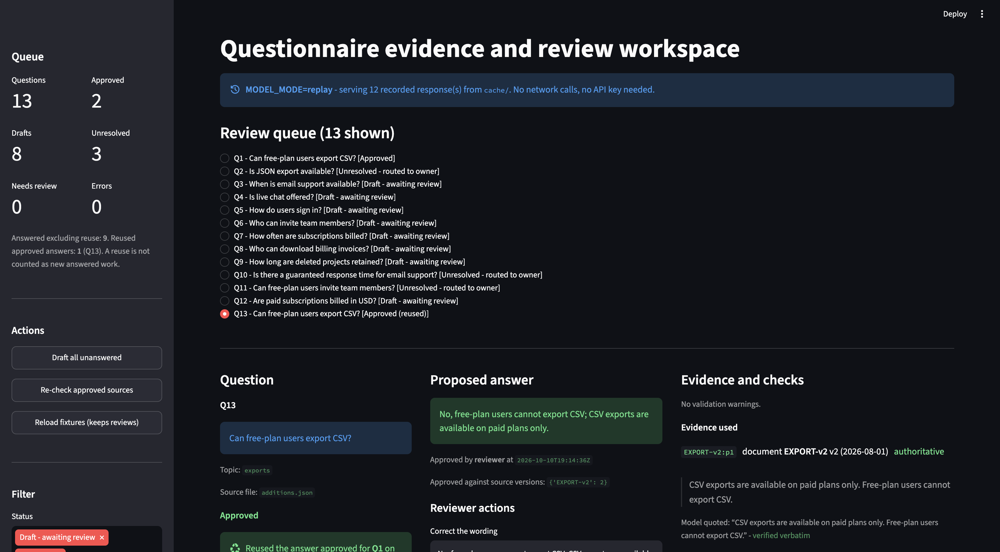

# Questionnaire Evidence & Review Workspace

Junior AI Engineer take-home, **Alternative C - Answer & approve**.
Starter pack `2026-10-02`, task folder `tasks/evidence/`.

A local workspace that drafts answers to buyer questionnaire questions from a company's own
documents, checks each answer against the passage it cites, routes anything it cannot
support to a named reviewer, and reuses a reviewer's approved wording on the next identical
question until a document it cites changes.

**Results at a glance**

- All five reference cases pass on real `claude-sonnet-4-5` responses, replayed from `cache/`
  (`checks/report-replay.txt`).
- All six failure-handling checks pass: API failure, invalid output, bad citations and
  conflicting sources (`checks/report-failures.txt`).
- Everything runs without an API key. Setup takes three commands (section 1).
- Written walkthrough: `docs/walkthrough.md`. AI usage and configuration: `notes/llm-usage.md`
  and `ai-workflow/`.



---

## 1. Quick start

Python 3.11+ (the final live run and all checks were run on CPython 3.12.11).

```bash
python -m venv .venv && source .venv/bin/activate
pip install -r requirements.txt

python -m app.loader --reset                      # load fixtures into SQLite
MODEL_MODE=replay python -m app.pipeline          # draft every question from recorded responses
MODEL_MODE=replay streamlit run app/ui.py         # open the review queue
```

Run the checks:

```bash
MODEL_MODE=replay python checks/run_checks.py     # the five reference cases
python checks/run_failure_checks.py               # failure handling, simulated and labelled
```

**No API key is needed for any of these commands.** `MODEL_MODE=replay` serves the real
model responses recorded in `cache/`. See section 3.

### Try the review flow in the UI

1. Select **Q1** and click **Approve**.
2. Select **Q13** (the same question text) and click **Re-draft from the model**. It comes
   back as **Approved (reused)**, with the approval record and sources of `Q1`.
3. In a second terminal, change the version of the document behind it:
   `python scripts/bump_source_version.py --mode bump`
4. Click **Re-check approved sources** (or reload the page). `Q1` and `Q13` move to
   **Needs review**, with a warning naming the version change, and stop being reused.
5. Restore the documents with `python scripts/bump_source_version.py --mode reset`.
   Reviewer state is kept.

---

## 2. What it does

```
 questions + documents
          |
   [ 1 ] reuse check ........... is there an approved answer to this exact question,
          |                      still backed by the versions it was approved against?
   [ 2 ] model draft ........... one call, whole corpus in context, JSON out
          |
   [ 3 ] evidence validation ... five deterministic checks (section 5)
          |
   [ 4 ] persist ............... SQLite: answer state + append-only audit trail
          |
   [ 5 ] review queue .......... question | answer | evidence, side by side
```

Answer states:

| state | meaning |
|---|---|
| `draft` | a model proposal that passed validation, or a human edit nobody has approved |
| `approved` | a reviewer signed off; **only this state may be reused** |
| `needs_review` | was approved, but a document behind it moved |
| `unresolved` | no checkable evidence; parked with the topic owner |
| `error` | the model could not be reached; the rest of the queue still ran |

---

## 3. Model access and replay

`MODEL_MODE` controls where responses come from.

| mode | behaviour | needs a key |
|---|---|---|
| `live` | calls the provider and **records every response** to `cache/<sha256>.json` | yes |
| `replay` | serves recorded responses, never touches the network — **the default** | no |
| `stub` | offline keyword stand-in for development | no |

The cache key is a SHA-256 of the model id, temperature, max tokens, system prompt and user
prompt. If any of them changes, the old response is not used. Temperature is 0, so a new
call would almost always return the same answer as the recorded one.

Each cache file holds the full request and response, so a reviewer can see what the model
was asked and what it answered.

### The stub is not a model run

`MODEL_MODE=stub` scores authoritative passages by keyword overlap and returns the best one.
It exists so the pipeline can be developed and tested without credentials. It is labelled
`stub` in the database, in the UI banner and in the check report, and it is **not** evidence
that the system works with a real model.

### Model access

The brief asks for model access agreed with the hiring team. The final run fell on a
Saturday, so rather than wait I used my own Anthropic API key with a small prepaid credit;
the whole live run cost a few cents. The key is not in the repository, and reviewing the
work needs no key at all, because replay serves the recorded responses.

### What is committed

`cache/` holds **12 real responses from `claude-sonnet-4-5`**, recorded on 2026-10-10 with
`MODEL_MODE=live` for the 13 questions (`Q13` has the same text as `Q1`, so it produces the
same prompt and shares one recorded response). Every committed check report was produced by
replaying them. To record fresh responses:

```bash
export MODEL_API_KEY=...            # never committed; see ai-workflow/.env.example
MODEL_MODE=live python -m app.pipeline --force
MODEL_MODE=replay python checks/run_checks.py --json checks/report-replay.json
```

`python -m app.pipeline` prints the status counts and exits non-zero if any question ended
in `error`, so a run where every call failed is easy to spot.

### How responses are labelled

| label | where it appears | meaning |
|---|---|---|
| `live` | `model_mode` on the answer row | a new provider call made in this run |
| `replay` | `model_mode`, UI banner, check report header | a recorded real response from `cache/` |
| `stub` | `model_mode`, UI banner, check report header | the offline keyword stand-in, not a model |
| `simulated` | `checks/run_failure_checks.py` and its report | a hand-written failing response, injected in place of the model and never written to `cache/` |

---

## 4. Layout

```
app/
  config.py        every tunable in one place
  storage.py       SQLite schema, reads and writes
  loader.py        fixtures -> SQLite; resolves document authority in code
  model_client.py  live / replay / stub, with the response cache
  drafting.py      prompt construction and strict JSON parsing
  validation.py    the five evidence checks
  review.py        edit, approve, version snapshots, reuse, staleness
  pipeline.py      the flow above, per question; `python -m app.pipeline` drafts them all
  ui.py            Streamlit review queue
data/
  starter-pack/    supplied files, UNCHANGED
  additions.json   my additions, with a _why on every entry
  reference-cases.json   five hand-derived cases
  source-change/   EXPORT-v3, applied on demand for RC-5
checks/run_checks.py     runs the five cases, prints expected vs observed
checks/run_failure_checks.py   simulated failures: API down, bad JSON, bad citations
checks/report-*.txt|json the committed results of both
scripts/bump_source_version.py   changes a document version, for RC-5
cache/           recorded real model responses, committed for replay
ai-workflow/     AI configuration manifest and notes
notes/llm-usage.md  tools, models, and one correction
docs/walkthrough.md written walkthrough of the approach
```

---

## 5. How each rule is implemented

Rules are from `data/starter-pack/domain.md`. They are the only source of truth used; no
outside product, security or compliance knowledge was applied.

### Rule 1 — only the supplied documents; undocumented means unknown

The system prompt restricts the model to the supplied passages and states that absence of
documentation means **unknown**, not absent. The model may not follow the prompt, so code
checks the result (`app/validation.py`):

| check | what it rejects |
|---|---|
| **C1 existence** | a cited passage id that does not exist |
| **C2 authority** | answering from a passage whose document was superseded, or a reported conflict with another *current* document, which no `supersedes` field can settle |
| **C3 verbatim** | a quoted excerpt that does not occur in the passage it is attributed to |
| **C4 coverage** | an answer whose cited evidence does not cover the question's content words |
| **C5 shape** | an "answered" verdict with no answer text or no surviving citation |

Any failure makes the answer `unresolved`. Validation can only move an answer to review; it
never turns an unresolved answer into an answered one.

C4 catches answers the documents do not support. For *"Is JSON export available?"*
the word `json` appears in no passage anywhere, so the question is undocumented. For
*"Can free-plan users invite team members?"* the words `free` and `plan` exist in the corpus
but not in the cited `ACCESS-v1:p1`, so the answer would be built on partial evidence. Both
are routed for review instead of answered.

### Rule 2 — authority comes only from `supersedes`

Resolved in `app/loader.py` before the model sees anything. A document is authoritative when
no other document declares `supersedes` pointing at it. Dates are loaded for display and take
no part in the decision, because the seed gives `EXPORT-v2`, `SUPPORT-v1`,
`ACCESS-v1` and `BILLING-v1` the same date, and my added `RETENTION-v2` is authoritative
despite being *older* than several current documents. Sorting by date would get both wrong.

The model is handed each passage pre-labelled `authority="authoritative"` or
`authority="superseded"`. It is not asked to work out authority, because code can apply
that rule exactly.

Replaced text stays available. Superseded passages are loaded, shown in the UI under
*"Conflicting earlier text (kept visible, not used)"*, and recorded per answer in
`conflicting_passage_ids`.

### Rule 3 — only approved answers are reused

`approve()` stores the answer **and a snapshot of the version of every document it cites**.
The snapshot is what lets a later version change be detected.

- An edit sets the state to `draft` and clears any previous approval, because the approved
  wording no longer matches what is stored.
- `refresh_source_change_flags()` runs on every queue load and before every reuse, so an
  outdated approval is never reused, even if nobody has opened that question.
- Reuse matches question text exactly, which the brief permits.

### Rule 4 — owners come from the supplied mapping

Every unresolved answer is routed by topic using the supplied `owners` map. A topic with no
entry produces an `owner_not_mapped` warning rather than an invented reviewer.

---

## 6. Data

The supplied seed in `data/starter-pack/` is **unchanged**. Additions are merged on top at
load time from `data/additions.json`.

**Generation method:** hand-written. No random generation was used, so no seed value applies.
Every added document and question carries a `_why` field explaining which check it serves.

| added | why |
|---|---|
| `RETENTION-v1` / `RETENTION-v2` | a second explicitly superseded pair, so authority logic is not tested only by the supplied CSV case. `RETENTION-v2` is dated *earlier* than several current documents on purpose. |
| `Q9` retention | supported answer requiring the new supersession to be resolved |
| `Q10` guaranteed response time | undocumented topic — nothing in the corpus mentions it |
| `Q11` free-plan invites | *partially* documented: invites are covered, plan tiers are not |
| `Q12` billed in USD | a plain supported control case |
| `Q13` | byte-identical text to `Q1`, which drives the reuse check |
| `data/source-change/EXPORT-v3.json` | applied on demand by `scripts/bump_source_version.py` for RC-5 |
| no owner for `retention` | the supplied mapping has no entry for the new topic, so none was added; the loader reports it under `missing_owner_topics` (assumption 6) |

Data preparation is included in the total time in section 10.

---

## 7. Reference cases

Five cases in `data/reference-cases.json`, one per minimum-demonstration bullet. **Expected
values were derived by hand** from the passages, with the derivation recorded in each case.
The application's output was never used as the answer key.

```bash
MODEL_MODE=replay python checks/run_checks.py --json checks/report-replay.json
```

Each case runs against a fresh throwaway database, so results do not depend on run order.

| case | covers | asserts |
|---|---|---|
| RC-1 | supported question | cites `SUPPORT-v1:p1`, excerpt verified verbatim |
| RC-2 | undocumented capability | `unresolved`, routed to Product reviewer, invents nothing |
| RC-3 | superseded conflict | cites `EXPORT-v2:p1`, shows `EXPORT-v1:p1` as conflict |
| RC-4 | approval and reuse | approved wording reused on `Q13`; an unapproved edit is not |
| RC-5 | source change | approved answer → `needs_review`, survives reload, control stays approved |

Latest result, replaying the recorded `claude-sonnet-4-5` responses: **5/5 passed**, see
`checks/report-replay.txt` (and `.json`).

### Failure handling (simulated, labelled)

The brief also asks for invalid model output, missing references and API failures to be
handled visibly. `checks/run_failure_checks.py` injects hand-written failing responses in
place of the model for one question at a time; every other question replays its real
recorded response. None of these responses came from a provider, and none is written to
`cache/`.

| case | simulated failure | expected and observed |
|---|---|---|
| F-1 | provider unavailable on `Q3` during a full batch | `Q3` → `error` with `model_unavailable`; the other 12 questions still processed |
| F-2 | output that is not JSON | `unresolved`, `invalid_model_output` |
| F-3 | citation to a passage id that does not exist | `unresolved`, `citation_not_found` |
| F-4 | a paraphrased "quotation" | `unresolved`, `excerpt_not_verbatim` |
| F-5 | an answer built on superseded `EXPORT-v1:p1` | `unresolved`, `citation_superseded` |
| F-6 | a reported conflict with another current document (`ACCESS-v1:p1`) | `unresolved`, `unresolved_conflict` |

Latest result: **6/6 passed**, see `checks/report-failures.txt` (and `.json`).

A real failure was also observed during the first live run: the account had no API credit,
every call returned HTTP 400, and all 13 questions were stored as `error` with the
provider's message while the batch completed. Nothing was cached from that run.

---

## 8. Assumptions and ambiguities

`domain.md` asks for ambiguities to be recorded. Each entry states the decision taken.

1. **`status` vs `supersedes` could disagree.** Each document carries both a `status` field
   and a `supersedes` graph. The rules do not say which wins if they conflict. **Decision:**
   the graph decides; the loader reports a mismatch as a discrepancy instead of correcting
   it. The supplied seed has no mismatch.

2. **Losing authority without a version change.** Rule 3 covers a referenced document's
   *version* changing. It does not cover a cited document being superseded by a new one while
   its own version stays the same, which is what `--mode supersede` does.
   **Decision:** treated as equivalent, because rule 2 forbids answering from a superseded
   passage, so an approval resting on one must go back for review. This gap was found
   during testing (`notes/llm-usage.md`, section 4b).

3. **What makes two questions "the same".** Not defined. The brief says exact matching is
   sufficient. **Decision:** exact text match, case- and whitespace-sensitive. `Q13` is
   byte-identical to `Q1` and reuses its answer. A paraphrase would not.

4. **How to decide something is undocumented.** Rule 1 says an undocumented feature is
   unknown but does not say how to tell. **Decision:** the lexical coverage test in C4. Its
   limitations are in section 9.

5. **Approving an unresolved answer.** Not addressed by the rules. **Decision:** the model's
   draft cannot be approved as it stands, because an approval should never be recorded
   against evidence that failed its checks. The owner it was routed to can supply wording,
   which makes it a `draft`, and then approve it: answering what the documents do not cover
   is why it was routed to them. Such an approval cites no document, so the UI shows it with
   no evidence, the validator's "undocumented" warnings stay visible on it, and there is no
   source version for a later change to invalidate.

6. **A new topic has no owner in the supplied mapping.** Rule 4 says to use the supplied
   topic-to-reviewer mapping, and it has no entry for the added `retention` topic.
   **Decision:** none was invented. The loader reports `retention` under
   `missing_owner_topics`, and an unresolved retention question would carry an
   `owner_not_mapped` warning instead of a guessed reviewer. `Q9` is answered from
   `RETENTION-v2`, so it needs no owner.

7. **Conflicts the metadata cannot settle.** The brief says to use the current document when
   explicit metadata resolves a conflict, and otherwise to leave the question for review.
   **Decision:** a conflict with a superseded passage is settled by `supersedes` and shown
   beside the answer; a reported conflict with another current document makes the answer
   `unresolved` (`unresolved_conflict`, check C2). The supplied corpus has no such pair, so
   this path is demonstrated with a simulated response (F-6).

8. **Approving again after a source change.** Rule 3 says to mark the answer for review; it
   does not say what review allows. **Decision:** if only a version number moved, the
   reviewer can approve again, which takes a fresh version snapshot and clears the warning.
   If a cited passage has been superseded, approval is refused until the answer is
   re-drafted from the current documents, because rule 2 forbids answering from it.

---

## 9. Known limitations

1. **C4 coverage is lexical, not semantic.** It compares normalised word sets with plural
   stripping and a generic English stoplist. It produces false `unresolved` on paraphrases:
   *"In which currency are subscriptions billed?"* is answerable from `BILLING-v1:p1`, but
   `currency` appears in no passage, so it would be routed for review. This was accepted on
   purpose: for answers that go to buyers, an extra item in the review queue costs less than
   a wrong answer. A production version would compare meaning (embeddings or an entailment
   check) and keep the word test as a quick first filter. No synonym list was added, because
   inventing product vocabulary is what `domain.md` forbids.

2. **No semantic check that the answer text follows from the excerpt.** C3 proves the
   quotation is real; nothing proves the prose conclusion is entailed by it. An LLM-as-judge
   second pass would be the next step, but it would need its own evaluation before being
   trusted.

3. **Reuse is exact-match only.** Any rewording misses, and the model is called again.

4. **Single-passage corpus.** Each supplied document has one passage, so multi-passage
   synthesis within one document is untested.

5. **No concurrency control.** Two reviewers approving the same answer at once would race.
   Out of scope for a local single-reviewer demo.

6. **One recorded run.** Each question was sent to the model once, at temperature 0. The
   checks show this run behaves as derived by hand; they do not measure how often a repeat
   call would differ, and thirteen fictional questions say nothing about accuracy on other
   data.

7. **Model end-of-life.** `claude-sonnet-4-5` is deprecated and reaches end-of-life on
   30 November 2026 (the SDK prints a warning). Replay keeps working after that date because
   it never calls the provider; a new live run would need `MODEL_ID` set to a current model,
   then the checks re-run on the newly recorded responses.

8. **Conflicts between current documents rely on the model reporting them.** The prompt
   asks the model to list conflicting *superseded* passages; it does not ask about
   disagreements between two current documents. Code rejects such a conflict when the model
   reports one (F-6), but would not find one the model did not report. The corpus has
   no such pair. Asking for it in the prompt would change every cache key and need a new
   recorded run.

9. **Optional enhancements.** Of the three the brief lists, a revision history is partly
   there: the **History** panel shows every draft, edit (with the before and after wording
   and the reviewer's note), approval and source-change flag for a question. Exporting a
   completed questionnaire and suggesting an approved answer for a differently worded
   question were not attempted. Embeddings, PDF parsing, CRM integration and sending answers
   to customers are outside the core scope.

---

## 10. Time spent

About **5–6 hours** in total, within the eight-hour limit. This includes reading the brief
and starter pack, preparing and checking the fixtures, building and correcting the
application with AI assistance, the live model run, verification, and documentation.

---

## 11. Submission map

| requirement | where |
|---|---|
| Git repository | this repo, with incremental commit history |
| Supplied seeds unchanged | `data/starter-pack/` |
| My additions and generation method | `data/additions.json`, section 6 |
| Five checked reference cases | `data/reference-cases.json` |
| Check results, expected vs observed | `checks/report-replay.*` (reference cases), `checks/report-failures.*` (simulated failures) |
| Saved real model responses | `cache/*.json` |
| Setup and run instructions | sections 1 and 3 |
| Architecture | sections 2, 4, 5 |
| Model configuration | section 3, `app/config.py` |
| Data assumptions | section 8 |
| Known limitations | section 9 |
| Replay without an API key | section 3 |
| Written walkthrough | `docs/walkthrough.md` |
| LLM usage note | `notes/llm-usage.md` |
| AI configuration | `ai-workflow/manifest.json`, `ai-workflow/README.md` |

All people, businesses, documents and policies in this repository are fictional and come from
the supplied starter pack.
